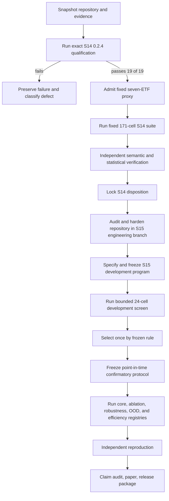

# FREM final upgrades and experiment master checklist

Date: 2026-10-24  
Current candidate: `FREM-S14-0.2.4`  
Current scientific status: `NOT_EVALUATED`  
Execution update: [preflight session](research/frem_final_execution_20261024T110832Z/REPORT.md); specific Kaggle upload confirmation pending.
Purpose: one ordered, copy-pastable execution checklist covering the remaining S14 experiment, repository hardening, bug closure, a separately versioned S15 extension, benchmarking, ablations, protected confirmation, independent reproduction, and publication evidence.

This is an execution specification, not evidence that the work has already run. A checked item needs the artifact named in that item. “Perfect” means every declared gate passes, every known limitation is either repaired or bounded, no critical/high defect remains open, and the final claim matches the evidence. It does not mean forcing a positive result.

## Immutable rules

- [ ] Preserve S2-S14 negative, mixed, failed, interrupted, invalid, and superseded evidence byte-for-byte.
- [ ] Do not edit the S14 0.2.4 source, wheel, archive, notebook, cohort, hashes, arms, seeds, folds, thresholds, budgets, or statistics.
- [ ] Do not inspect protected outcomes before a signed scientific freeze.
- [ ] Do not tune after a protected result, change the 0.01-nat threshold, choose a favorable bootstrap block, drop failed seeds, or shrink a denominator.
- [ ] Treat qualification, unit tests, package builds, and notebook completion as engineering evidence only.
- [ ] Treat the S14 adjusted-close ETF suite as a historical proxy, never as point-in-time or investable evidence.
- [ ] Give every science-changing repair or feature a new version, protocol, output root, freeze, and decision record.
- [ ] Refuse every run that would overwrite an existing output directory.
- [ ] Retain failures with source, config, data, environment, traceback, partial-cell inventory, elapsed time, and resource facts.
- [ ] Use only admitted resources: local numerical work requires at least 512 MiB free-plus-speculative memory and stable pageouts; CUDA work requires exact-host qualification.
- [ ] Make no live trade, broker order, public submission, or third-party message.

## Program flow

Each arrow is fail-closed. Do not skip a failed gate by starting its downstream work.

## Stage 0 — Capture the exact starting state

- [x] Record current branch `codex/frem-research-execution-20261020`.
- [x] Record current candidate `FREM-S14-0.2.4` and status `NOT_EVALUATED`.
- [x] Inventory 4,902 pre-existing untracked files without deleting or staging them.
- [x] Record the private Kaggle owner, notebook, visibility, accelerator, input, version history, Internet setting, persistence setting, and environment pin.
- [x] Record that no 0.2.4 saved version or run has been observed.
- [x] Record that local numerical admission failed and no local S14 numerical work is authorized by current resource facts.
- [ ] Re-run `git status --short --branch` immediately before every mutation batch.
- [x] Verify the four exact 0.2.4 identities against `dist/RELEASE-0.2.4.json`.
- [ ] Re-run the untracked-evidence inventory and compare counts/hashes before staging.
- [x] Create a session directory with UTC timestamp, branch, HEAD, dirty-state hash, operator, host, and purpose.
- [x] Add an append-only session receipt before any external upload or numerical run.
- [ ] Stop if the branch, release identities, account, notebook, dataset, accelerator, or visibility differs from the recorded contract.

**Acceptance evidence:** a fresh session receipt and unchanged release hashes.

## Stage 1 — Finish the immutable S14 0.2.4 campaign

### 1.1 Upload and saved-source readback

- [ ] Obtain action-time confirmation before using the browser file picker for the private Kaggle upload.
- [x] Confirm the notebook is `ryangomez010/frem-s14-gpu-benchmark-20261019` and private.
- [x] Confirm no duplicate 0.2.4 version is queued, running, or complete.
- [ ] Upload the exact generated 0.2.4 notebook and metadata from `successors/frem_s14/kaggle/`.
- [ ] Keep GPU `T4 x2`, Internet off, persistence off, pinned environment, and the declared input.
- [ ] Save a new version without replacing Versions 1-8.
- [ ] Download/read back the saved source before execution.
- [ ] Hash the readback source and compare it with the local release record.
- [ ] Record notebook version, script version, account, creation time, accelerator, environment, input slug/version, and source hash.
- [ ] Abort before execution if any identity differs.

### 1.2 Generated qualification

- [ ] Run dependency/runtime checks before importing scientific modules.
- [ ] Run the complete packaged test directory with warnings treated as errors.
- [ ] Run all 19 generated qualification arms on CUDA.
- [ ] Run the frozen qualification seed `11` for each of the 19 arms. Seeds `11`, `29`, and `47` belong to the historical suite, not generated qualification.
- [ ] Preserve per-cell stdout, stderr, checkpoint, metrics, traces, wall time, peak RSS/VRAM, parameter count, and environment.
- [ ] Verify every target, score vector, split, calendar, retrieval trace, ledger, and completion receipt independently.
- [ ] Require 19/19 arms and every declared seed/config family to be complete.
- [ ] Refuse CPU substitution, reduced arms, reduced seeds, shorter denominator, or timeout-driven success.
- [ ] Preserve any incomplete qualification as a failed attempt and classify its defect before another version exists.

### 1.3 Historical-proxy intake

- [ ] Admit only `SPY`, `IWM`, `DIA`, `TLT`, `IEF`, `GLD`, and `SLV`.
- [ ] Verify every allowlisted source hash before parsing.
- [ ] Preserve QQQ exclusion and prohibit intersection/fill repair.
- [ ] Validate schema, dates, ordering, duplicates, finiteness, calendar, and minimum history.
- [ ] Preserve the adjusted-close, survivor-selected, non-point-in-time purpose label.
- [ ] Write a new immutable intake directory and manifest.
- [ ] Recompute the canonical panel hash independently.

### 1.4 Fixed historical suite

- [ ] Run fold ends `2011-01-01`, `2015-01-01`, and `2018-01-01`.
- [ ] Run all 19 declared arms.
- [ ] Run seeds `11`, `29`, and `47`.
- [ ] Enforce 10 epochs, patience 3, horizon 20, embargo 20, and 4,000 seconds per fold.
- [ ] Enforce the 13,500-second notebook ceiling.
- [ ] Produce exactly `19 arms × 3 seeds × 3 folds = 171` cell identities.
- [ ] Preserve started, complete, failed, interrupted, and timeout states in the denominator.
- [ ] Never compare an incomplete family by silently dropping missing cells.
- [ ] Run mandatory in-run semantic verification before a fold can be terminal-complete.

### 1.5 Independent verification and disposition

- [ ] Download the output archive without changing the Kaggle copy.
- [ ] Run dependency-free archive verification against the separately trusted 0.2.4 release digest.
- [ ] Verify manifest closure and reject extra, missing, duplicated, renamed, special, or mutated files.
- [ ] Set `FREM_S14_DOWNLOADED_SUITE` to the new immutable download directory and run `frem-s14 verify-suite --bundle "$FREM_S14_DOWNLOADED_SUITE"` on an admitted numerical host.
- [ ] Recompute all 171 score vectors from raw retained predictions.
- [ ] Aggregate complete seeds per observation, assets equally within UTC date, then dates equally.
- [ ] Recompute paired circular moving-date-block intervals with block 20, 2,000 repetitions for S14, and the declared seed.
- [ ] Recompute the complete Holm-adjusted secondary family.
- [ ] Compare independent results with producer summaries field by field.
- [ ] Classify S14 once as `SUPPORTED`, `MIXED`, `NEGATIVE`, `INCONCLUSIVE`, or `INVALID`.
- [ ] Write the disposition, exact scope, limitations, and every failed cell to canonical state.
- [ ] Freeze S14 artifacts and prohibit outcome-motivated reruns.

**Stage 1 acceptance:** exact 0.2.4 has a retained terminal disposition; 19/19 qualification arms and 171/171 proxy cells either verify or the campaign is honestly classified incomplete/invalid.

## Stage 2 — Full bug and flaw eradication program

All fixes in this stage target a new engineering version. A fix that changes numerical behavior receives a scientific decision record and cannot retroactively repair S14 evidence.

### 2.1 Defect census and triage

- [ ] Create `research/frem_s15_engineering/DEFECT_LEDGER.jsonl` with one immutable record per defect.
- [ ] Search source, tests, configs, docs, workflows, manifests, notebooks, and retained failures for `TODO`, `FIXME`, skipped tests, warnings, broad exceptions, silent fallbacks, and stale version strings.
- [ ] Reconcile every S10-S14 failure receipt with a current defect or closed historical cause.
- [ ] Give every defect a stable ID, severity, affected versions, reproducer, root cause, scientific impact, repair, regression test, and closure evidence.
- [ ] Classify severity as critical, high, medium, or low using data corruption, leakage, evidence loss, wrong score, wrong model, nondeterminism, crash, and usability criteria.
- [ ] Block release for any open critical/high defect.
- [ ] Require a failing regression test before each reproducible repair.
- [ ] Preserve nonreproducible reports with environment and attempted reproduction evidence.
- [ ] Record whether each repair is byte-equivalent, tolerance-equivalent, or science-changing.

### 2.2 Configuration and API correctness

- [ ] Replace ad hoc config acceptance with versioned schemas and strict unknown-field rejection.
- [ ] Validate all ranges, enum values, dimensions, units, budgets, paths, and cross-field invariants before imports or data reads.
- [ ] Canonicalize config serialization and hash the canonical bytes.
- [ ] Separate engineering, development, proxy, and confirmatory config types.
- [ ] Prevent protected commands from accepting development-only config.
- [ ] Make every CLI command return stable documented exit codes.
- [ ] Add `--json` machine-readable output to planning, admission, status, and verification commands.
- [ ] Add `frem-s15 doctor` for environment, device, storage, memory, clock, and dependency diagnosis.
- [ ] Add `frem-s15 plan` that expands every registry cell and cost before execution.
- [ ] Add `frem-s15 status` that reports complete, failed, active, missing, and duplicate cells without reading protected metrics.

### 2.3 Data and leakage correctness

- [ ] Enforce UTC timezone-aware timestamps at every boundary.
- [ ] Separate observation time, publication time, availability time, decision time, execution time, and outcome maturity time.
- [ ] Assert `availability <= decision < execution <= label_end` for every row.
- [ ] Fit preprocessing only on the training prefix and serialize its sufficient statistics.
- [ ] Recompute labels from primitive prices in an independent implementation.
- [ ] Reject duplicate identifiers, duplicate timestamps, nonmonotonic calendars, stale values, and accidental future joins.
- [ ] Add controlled future-feature canaries and prove the pipeline rejects them.
- [ ] Add time-shuffled and asset-permuted negative controls.
- [ ] Test embargo and purge boundaries at exact off-by-one dates.
- [ ] Make missingness explicit: not-listed, closed, halted, suspended, provider-gap, stale, terminal, and parse-failed.
- [ ] Prohibit generic forward/back fill across lifecycle or availability boundaries.
- [ ] Validate all source hashes and licenses before parsing.

### 2.4 Numerical and model correctness

- [ ] Add finite checks after every transform, loss term, gradient, optimizer step, predictive parameter, and score.
- [ ] Validate Student-mixture weights, scales, degrees of freedom, normalization, and variance decomposition against hand calculations.
- [ ] Validate compounded multi-horizon targets against a second implementation.
- [ ] Validate spectral transforms with analytical sine, impulse, constant, and noise cases.
- [ ] Validate diffusion operators for conservation, boundary conditions, stability, and gradients.
- [ ] Validate reservoir contraction/spectral-radius constraints at initialization and every checkpoint.
- [ ] Validate graph eligibility so no contemporaneous or future information can enter an edge.
- [ ] Validate memory writes, eligibility, eviction, retrieval, and delayed credit with exact event traces.
- [ ] Validate router caps, expert balance, dead experts, and uniform-router equivalence.
- [ ] Validate neurogenesis capacity, initialization, optimizer registration, checkpoint restore, and contraction after growth.
- [ ] Compare CPU float64 reference, CPU float32, CUDA float32, TF32, and mixed precision at frozen tolerances.
- [ ] Fail closed on nonfinite values, degenerate mixtures, unstable states, empty admissible memory, or malformed checkpoints.

### 2.5 Artifact, resume, and failure safety

- [ ] Use a legal campaign state machine: prepared → admitted → running → interrupted/failed/complete → verified → released.
- [ ] Use two-phase artifact commit: stage, hash/verify, then atomically publish the terminal manifest.
- [ ] Hash every source, config, input, split, environment, cell, checkpoint, prediction, trace, summary, figure, and paper artifact.
- [ ] Add schema IDs and validators to every receipt.
- [ ] Refuse symlinks, path traversal, devices, sockets, FIFOs, and archive bombs.
- [ ] Prevent manifest self-inclusion and verify manifest closure.
- [ ] Record UTC wall time plus monotonic elapsed time and detect clock jumps.
- [ ] Project worst-case storage before launch and fail before exhaustion.
- [ ] Make checkpoint writes atomic and verify their hashes before resume.
- [ ] Charge prior elapsed time and completed work exactly once on resume.
- [ ] Fuzz interruption at training, checkpoint, scoring, export, manifest, and verification boundaries.
- [ ] Prove resumed and uninterrupted runs are equivalent within the frozen tolerance.
- [ ] Add a duplicate-run fingerprint over source, config, data, account, host, notebook, registry, and freeze.

### 2.6 Test system

- [ ] Keep fast stdlib/static tests runnable without NumPy/Torch imports.
- [ ] Add unit tests for every pure operator and schema.
- [ ] Add property tests for shapes, ordering, invariants, serialization, and scores.
- [ ] Add metamorphic tests for permutation, time shift, scaling, masking, and batching invariance where mathematically expected.
- [ ] Add gradient checks on reduced analytical cases.
- [ ] Add differential tests against independent metric, bootstrap, ledger, and label implementations.
- [ ] Add malformed-input fuzzing for JSON, CSV, archives, manifests, and configs.
- [ ] Add deterministic golden fixtures with source provenance and no protected outcomes.
- [ ] Add target-runtime integration tests on CPU and CUDA.
- [ ] Add end-to-end dry runs that exercise failure and resume paths.
- [ ] Add mutation testing for high-risk admission, split, scoring, and manifest code.
- [ ] Require branch coverage for every fail-closed path.
- [ ] Require zero warnings under the supported interpreter/dependency matrix.
- [ ] Require Ruff, formatting, type checking, build, clean-wheel install, source tests, wheel tests, and artifact verification.

### 2.7 Performance and maintainability

- [ ] Profile data loading, feature construction, model forward/backward, memory retrieval, graph operations, scoring, serialization, and verification separately.
- [ ] Record wall time, CPU time, peak RSS, peak VRAM, I/O bytes, parameters, gradient steps, and examples/second per cell.
- [ ] Remove repeated transforms and host-device transfers only after equivalence tests.
- [ ] Implement bounded streaming feature construction with reference equivalence.
- [ ] Implement deterministic resource-aware sharding with no missing or duplicate cells.
- [ ] Add activation checkpointing only if tolerance-equivalent and measurably useful.
- [ ] Add structured logs keyed by campaign, registry cell, seed, fold, arm, and attempt.
- [ ] Generate API, config, artifact-schema, and command documentation from versioned definitions.
- [ ] Delete dead code only after proving it is unreferenced by current and historical verifiers.
- [ ] Keep historical parsers needed to verify retained evidence.

**Stage 2 acceptance:** no open critical/high defect; every repair has a reproducer and regression test; clean source and wheel pass the declared matrix; exact resume and artifact safety pass fault injection.

## Stage 3 — FREM-S15 final extension specification

S15 is a new falsifiable study. Its working question is: **Does reliability-gated, hierarchical causal memory improve out-of-time proper scoring over S14 full and matched memory controls under equal information, capacity, validation access, and compute?** Final wording must be frozen before outcomes.

### 3.1 Model extensions to implement

- [ ] Add a train-only confidence-aware memory write gate based on delayed matured evidence.
- [ ] Add short-, medium-, and long-timescale memory banks under the same total capacity as the flat-memory control.
- [ ] Add learned delayed-credit eviction with a deterministic FIFO fallback.
- [ ] Add retrieval diversity regularization and expose coverage/redundancy traces.
- [ ] Add uncertainty-weighted graph edges with minimum-support and no-edge fallback.
- [ ] Add causal lag/permutation graph controls.
- [ ] Add adaptive spectral frequencies with anti-collapse and bandwidth regularization.
- [ ] Add a per-checkpoint reservoir stability certificate and inference alarm.
- [ ] Add a sparse interpretable router option with identical information and compute accounting.
- [ ] Add coherent 1-, 5-, and 20-step predictive paths with marginal-consistency checks.
- [ ] Add a predictive law capable of representing total loss and terminal events.
- [ ] Add calibrated epistemic uncertainty from a predeclared seed ensemble without test-time tuning.
- [ ] Add abstention/cash output only as a separately evaluated policy, never as hidden forecast filtering.
- [ ] Keep each extension independently switchable for ablation.
- [ ] Keep total capacity, parameter count, and compute-matched alternatives available.

### 3.2 Strong baselines and controls

- [ ] Zero-return baseline.
- [ ] Historical-mean baseline using training data only.
- [ ] Random-walk/last-value baseline where dimensionally valid.
- [ ] EWMA volatility and Student-t baseline.
- [ ] Ridge regression.
- [ ] Elastic net.
- [ ] VAR or dynamic linear model with a stable low-dimensional specification.
- [ ] XGBoost.
- [ ] Hybrid XGBoost using exactly the declared causal features.
- [ ] GRU.
- [ ] DLinear.
- [ ] PatchTST/patch-transformer implementation with matched development budget.
- [ ] S14 full model locked as a predecessor control.
- [ ] S15 no-memory control with all nonmemory changes retained.
- [ ] Capacity-matched FIFO memory.
- [ ] Capacity-matched uniform memory.
- [ ] Parameter-matched dense control.
- [ ] Compute-matched control receiving the same wall/step budget.

### 3.3 S15 development registry — exactly 24 cells

Use one development-only chronological split, three seeds (`11`, `29`, `47`), and eight arms. Do not exceed 24 cells or 12 total wall-clock hours without a new recorded authorization.

- [ ] `s15_full` × 3 seeds.
- [ ] `s14_full_locked` × 3 seeds.
- [ ] `s15_no_memory` × 3 seeds.
- [ ] `s15_no_write_gate` × 3 seeds.
- [ ] `s15_flat_memory` × 3 seeds.
- [ ] `s15_fifo_capacity_matched` × 3 seeds.
- [ ] `s15_fixed_spectral` × 3 seeds.
- [ ] `s15_no_edge_uncertainty` × 3 seeds.
- [ ] Freeze a deterministic selection rule before running: primary development NLL, then calibration, then resource ceiling; no protected information.
- [ ] Select once; if no candidate clears the predeclared development threshold, freeze a negative development disposition and do not confirm.

### 3.4 Data program

- [ ] Keep the S14 fixed ETF proxy as a diagnostic continuity dataset only.
- [ ] Acquire a point-in-time security master with permanent identifiers and membership intervals.
- [ ] Include inactive securities, delistings, mergers, spinoffs, bankruptcies, and terminal distributions.
- [ ] Acquire unadjusted prices, distributions, splits, executable quote fields, volume, and exchange calendars.
- [ ] Acquire dated FX where instruments or liabilities cross currencies.
- [ ] Acquire macro/filing/event features only with original publication and revision timestamps.
- [ ] Record provider, extraction time, query, license, rights, bytes, hash, and transformation lineage.
- [ ] Build an untouched protected chronological tail with no prior outcome access.
- [ ] Build a separate unused OOD market/sector/time region.
- [ ] Build synthetic mechanistic datasets with known regimes, memory dependence, null memory, graph dependence, and controlled shift.
- [ ] Freeze population, inclusion/exclusion, lifecycle rules, missingness, labels, splits, purge, embargo, and horizon before protected access.

## Stage 4 — Full benchmark, ablation, and evaluation program

### 4.1 Core confirmatory registry — 210 cells

Run 14 arms × 5 seeds (`11`, `29`, `47`, `71`, `97`) × 3 frozen chronological folds. Every arm receives identical data, split, validation access, stopping policy, and declared budget.

- [ ] S15 full candidate.
- [ ] S14 full locked predecessor.
- [ ] S15 no-memory mechanism-off control.
- [ ] FIFO capacity-matched memory.
- [ ] Uniform capacity-matched memory.
- [ ] Parameter-matched dense control.
- [ ] Compute-matched no-memory control.
- [ ] Zero/historical-mean simple control chosen by the frozen rule.
- [ ] Ridge.
- [ ] EWMA Student-t.
- [ ] XGBoost.
- [ ] GRU.
- [ ] DLinear.
- [ ] PatchTST.
- [ ] Expand and hash all 210 registry identities before execution.
- [ ] Refuse inference from any comparison whose complete paired denominator is unavailable.

### 4.2 Mechanism ablation registry — 18 arms × 3 seeds × 3 folds = 162 cells

- [ ] Full S15.
- [ ] No memory.
- [ ] No confidence write gate.
- [ ] Single flat memory bank.
- [ ] FIFO eviction.
- [ ] No diversity regularizer.
- [ ] No graph.
- [ ] Fixed graph weights.
- [ ] No edge uncertainty.
- [ ] No spectral branch.
- [ ] Fixed spectral bank.
- [ ] No JEPA objective.
- [ ] No reservoir.
- [ ] No neurogenesis.
- [ ] Fixed full capacity.
- [ ] Uniform router.
- [ ] No multi-horizon coupling.
- [ ] No risk/calibration objective.
- [ ] Freeze this as a secondary Holm-adjusted family before execution.

### 4.3 Robustness registry

Run S15 full, S15 no-memory, and the strongest frozen simple/learned baseline under the same perturbations.

- [ ] Input noise standard deviation `0.01`.
- [ ] Input noise standard deviation `0.05`.
- [ ] Missing-feature probability `0.10`.
- [ ] Missing-feature probability `0.30`.
- [ ] One-session feature delay.
- [ ] One-session execution delay.
- [ ] Cost multipliers `1×`, `2×`, and `4×`.
- [ ] Calendar half-days and asynchronous-market stress.
- [ ] Corporate-action boundary stress.
- [ ] Terminal-loss/delisting stress.
- [ ] Low-liquidity and widened-spread stress.
- [ ] Regime-transition and volatility-jump stress.
- [ ] Preserve the full perturbation denominator and failure counts.

### 4.4 OOD and generalization registry

- [ ] Predeclare one held-out market.
- [ ] Predeclare one held-out sector or asset class.
- [ ] Predeclare crisis, recovery, calm, and high-inflation intervals without selecting from model outcomes.
- [ ] Test asset cold-start without assigning an existing asset identity.
- [ ] Test longer-than-trained regime duration.
- [ ] Test support shift and heavier tails.
- [ ] Test missing-feature mechanisms unseen in training.
- [ ] Report in-domain and OOD results separately.
- [ ] Make no universal-generalization claim from a single OOD slice.

### 4.5 Sensitivity, scaling, and efficiency

- [ ] Training fractions `0.10`, `0.25`, `0.50`, and `1.00` using chronological suffixes only.
- [ ] Context lengths `32`, `64`, and `128`.
- [ ] Memory capacities `128`, `512`, and `2048` with matched controls.
- [ ] Spectral bands `4`, `8`, and `16`.
- [ ] Horizons `1`, `5`, and `20` with correct purge/embargo.
- [ ] Small, base, and large parameter budgets.
- [ ] CPU and CUDA inference throughput.
- [ ] Batch-size throughput curve under a fixed deterministic rule.
- [ ] Peak RSS and VRAM versus sequence length, assets, capacity, and batch size.
- [ ] Checkpoint size, load time, resume overhead, and verifier time.
- [ ] Score improvement per parameter, gradient step, GPU-hour, and joule if measurable.
- [ ] Report Pareto frontiers rather than a single favorable efficiency number.

### 4.6 Metrics and statistics

- [ ] Primary endpoint: mean date-level Student-t negative log likelihood, lower is better.
- [ ] Primary contrast: complete-seed S15 full versus S15 no-memory.
- [ ] Minimum practical improvement: 0.01 nats per observation unless a new rationale is frozen before confirmation.
- [ ] Statistical unit: decision date with contemporaneous assets retained together.
- [ ] Average complete seeds per observation, assets equally within date, then dates equally.
- [ ] Use paired circular moving-date-block bootstrap with 5,000 repetitions for final confirmation.
- [ ] Freeze block 20 and sensitivity blocks 5 and 60; never select the favorable block.
- [ ] Apply Holm correction to the predeclared mechanism family.
- [ ] Report effect, 95% interval, adjusted p-value where applicable, practical threshold, raw fold points, seed heterogeneity, and failures.
- [ ] Report MAE, rank correlation by date, directional Brier score, interval coverage, interval width, CRPS, and calibration error as secondary endpoints.
- [ ] Report net certainty equivalent, drawdown, turnover, shortfall, and break-even costs only from synchronized nonoverlapping realizable ledgers.
- [ ] Report parameter count, steps, wall time, CPU, peak RSS, peak VRAM, and throughput.
- [ ] Report memory occupancy, write acceptance, age, retrieval utility, bank usage, diversity, and graph-support traces.
- [ ] Add superiority, inferiority, and practical-equivalence regions around the frozen threshold.
- [ ] Bound missing-cell conclusions conservatively instead of dropping cells.
- [ ] Run simulation calibration proving interval coverage/type-I behavior under declared dependence.

### 4.7 Falsification and adversarial checks

- [ ] Require no advantage on time-shuffled labels.
- [ ] Require no advantage on asset-permuted labels.
- [ ] Require future-feature canaries to be rejected or exposed.
- [ ] Require the null-memory synthetic world to favor no added mechanism after complexity cost.
- [ ] Require the known-memory synthetic world to recover the planted delay and retrieval source.
- [ ] Shift graph lags and require contemporaneous leakage to disappear.
- [ ] Compare against additional-parameter and additional-compute controls.
- [ ] Test whether a simpler distilled model preserves any gain.
- [ ] Audit whether gain comes from forecasts, uncertainty, or allocation policy using a law-by-policy factorial.
- [ ] Publish failure cases and counterexamples with the same prominence as successes.

**Stage 4 acceptance:** registries were immutable before outcomes; all denominators reconcile; primary and secondary inference independently recompute; failed cells remain visible; the disposition follows the frozen rule.

## Stage 5 — Portfolio and decision evaluation

- [ ] Keep forecast quality separate from portfolio utility.
- [ ] Cross each forecast law with each fixed allocation policy.
- [ ] Cross each policy with zero, historical, and risk-only forecast controls.
- [ ] Include cash, buy-and-hold, equal weight, risk parity, and no-trade controls.
- [ ] Use identical holdings, rebalance dates, costs, constraints, and terminal accounting.
- [ ] Model bid/ask, fees, impact, turnover, taxes, FX, liquidity, and execution delay as explicit assumptions.
- [ ] Reconstruct every wealth ledger independently.
- [ ] Decompose turnover into forecast, covariance, constraint, schedule, and lifecycle components.
- [ ] Decompose exposure, volatility, drawdown, tail loss, concentration, cash, and shortfall.
- [ ] Report cost/capacity break-even curves without claiming real executability.
- [ ] Reject missing or ambiguous mandate inputs.
- [ ] Never describe adjusted-close proxy ledgers as live-tradable performance.

## Stage 6 — Reproducibility, security, and supply chain

- [ ] Pin Python, OS, CUDA, drivers, BLAS, compiler, and every dependency.
- [ ] Build deterministic sdist, wheel, notebook bundle, and verifier archive.
- [ ] Install and test from source and clean wheel in fresh environments.
- [ ] Generate an SBOM and dependency-license report.
- [ ] Run dependency-vulnerability, secret, credential, private-data, unsafe-deserialization, archive, and path-traversal scans.
- [ ] Record unresolved advisories with reachability and mitigation.
- [ ] Sign release manifests and document key custody/rotation.
- [ ] Create a read-only clean-host reproduction package.
- [ ] Ensure the reproducer cannot mutate producer outputs.
- [ ] Reconstruct data lineage, splits, raw scores, bootstrap, tables, and figures independently.
- [ ] Reconcile every discrepancy explicitly.
- [ ] Preserve independent operator, host, environment, start/end time, and artifact hashes.

## Stage 7 — Paper, figures, and final release

- [ ] Build a machine-readable claim ledger: claim → protocol → cells → raw artifact → analysis → table/figure.
- [ ] Generate tables and figures only from independently verified arrays.
- [ ] Show raw fold points, uncertainty, threshold, missing cells, and failure counts.
- [ ] Include full baseline, ablation, robustness, OOD, scaling, efficiency, and negative-result tables.
- [ ] Include retrieval, router, memory-bank, graph, reservoir, neurogenesis, diffusion, and calibration diagnostics.
- [ ] Include a negative-evidence timeline covering S2-S15 without implying monotonic improvement.
- [ ] Update methods, results, discussion, limitations, conclusion, data statement, and reproducibility statement.
- [ ] Remove every unsupported causality, profitability, SOTA, novelty, point-in-time, calibration, safety, or generalization claim.
- [ ] Verify every number from machine-readable evidence.
- [ ] Verify every citation against the exact statement and current source.
- [ ] Compile the paper from a clean environment.
- [ ] Render and visually inspect every page, table, figure, equation, reference, and link.
- [ ] Generate final source, data, artifact, paper, and environment manifests.
- [ ] Verify code/data/figure redistribution rights.
- [ ] Freeze exact release commit and tag only after all gates pass.
- [ ] Update `RESEARCH_STATE.json` with the terminal disposition and exact scope.
- [ ] Obtain separate authorization before push, external delivery, or public submission.

## One-shot orchestration implementation

Build this only in the S15 engineering version. It coordinates stages but never converts a failure into a skip or a pass.

- [ ] Implement `scripts/frem_final_program.py plan` to emit the full DAG, registry counts, resource/storage projection, and hashes without numerical imports.
- [ ] Implement `scripts/frem_final_program.py audit` to verify branch, dirty state, releases, freezes, inputs, rights, resources, and duplicate runs.
- [ ] Implement `scripts/frem_final_program.py execute --stage "$FREM_STAGE" --output "$FREM_NEW_OUTPUT_ROOT"` with explicit stage allowlisting and no overwrite.
- [ ] Implement `scripts/frem_final_program.py resume --receipt "$FREM_RESUME_RECEIPT"` with exact charged-time and checkpoint verification.
- [ ] Implement `scripts/frem_final_program.py verify --bundle "$FREM_RESULT_BUNDLE"` using independent parsers and recomputation.
- [ ] Implement `scripts/frem_final_program.py status --root "$FREM_CAMPAIGN_ROOT"` without revealing protected metrics.
- [ ] Implement `scripts/frem_final_program.py finalize --bundle "$FREM_RESULT_BUNDLE"` to write a terminal manifest only after all validators pass.
- [ ] Require explicit `--execute` for numerical work and print the expanded plan first.
- [ ] Require a new output root and refuse existing paths.
- [ ] Require the appropriate freeze for protected stages.
- [ ] Preserve SIGINT, SIGTERM, timeout, OOM, quota, disk-full, and verifier failures.
- [ ] Stop the DAG on any failed admission, missing cell, hash mismatch, semantic mismatch, or rights failure.
- [ ] Never automatically retry a protected run.

## Final acceptance checklist

- [ ] S14 0.2.4 has an immutable terminal disposition.
- [ ] S15 exists as a separate version and never rewrites S14 history.
- [ ] No open critical/high bug remains.
- [ ] Every known flaw maps to repair evidence or an explicit bounded limitation.
- [ ] Every implemented feature has an ablation and a falsifier.
- [ ] Every baseline has equal information and documented compute/parameter parity.
- [ ] Every planned cell is complete, failed, or missing with the full denominator preserved.
- [ ] All primary statistics independently recompute from raw predictions.
- [ ] Point-in-time data and protected boundaries support the scope of the final claim.
- [ ] Robustness, OOD, scaling, and efficiency evidence support any related claim.
- [ ] Independent reproduction succeeds or its discrepancy limits the claim.
- [ ] Paper claims, tables, figures, code, data, and receipts share exact identities.
- [ ] Negative and invalid evidence remains accessible.
- [ ] Final status is one honest member of `SUPPORTED`, `MIXED`, `NEGATIVE`, `INCONCLUSIVE`, or `INVALID`.

The program is done only when a competent independent researcher can reconstruct the terminal conclusion from admitted inputs and raw retained evidence without trusting the producer summary.
