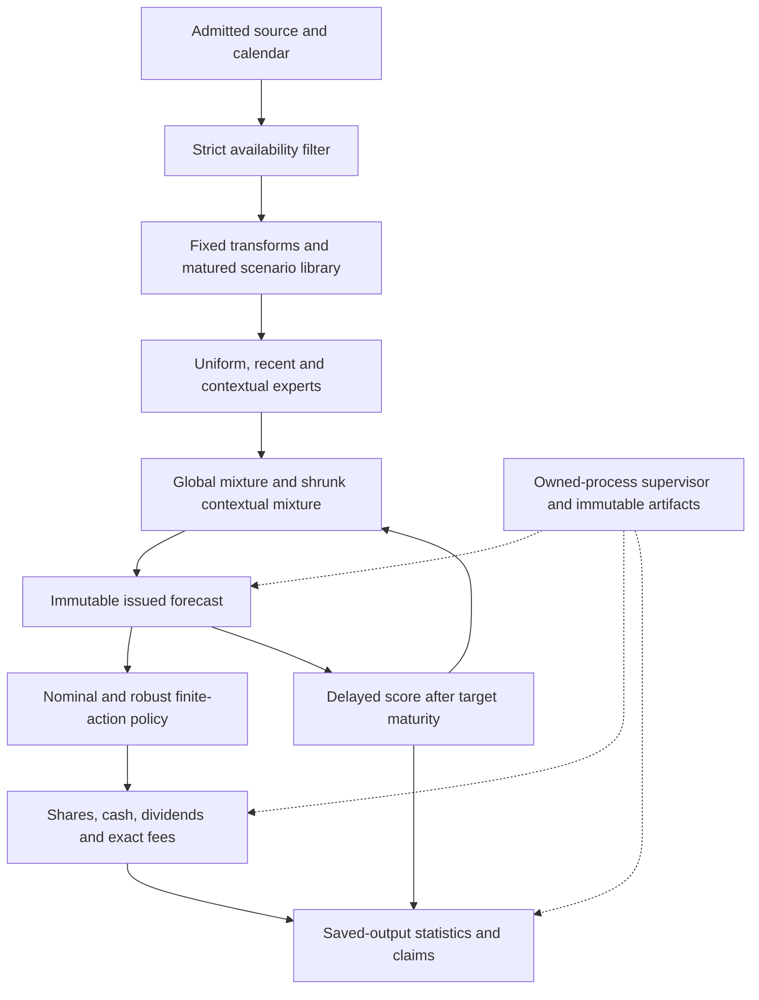

# FREM S10: complete implementation blueprint, revision 2

15 October 2026. **Design complete for implementation planning; S10 is not implemented, tested, frozen or empirically evaluated.** This extends the preserved [first design](FREM_S10_DESIGN.md) into a model, software, verification, operations and delivery contract. The task is to make the proposed study precise and falsifiable. Neither documentation nor excellent software can guarantee a market advantage.

## What S10 is intended to establish

S10 asks whether delayed contextual fitting of a joint predictive mixture improves a proper forecast score over global and equal mixing, and whether a holdings-aware robust policy converts that improvement into net wealth under explicit costs. It uses finite joint four-week price/dividend scenarios for SPY, TLT and GLD, fixed burn-in transforms, three simple experts, regularized mixture optimization and local-to-global shrinkage. Exact fee accounting, a cash action and simple investment controls can expose a failed mechanism rather than conceal it.

The proposed development matrix stays fixed at **192 ledgers: 128 strategy, 48 benchmark and 16 ablation**. The planned primary score margin is a separate 5% energy-score hypothesis; it cannot satisfy the original 0.01-nat density hypothesis. The 6% relative ending-wealth objective remains unchanged. Current-vintage reused history supports only the declared retrospective development question. Untouched confirmation, novelty and independent reproduction remain unestablished.

## Read the plan

| Area | Authoritative deliverable | What is specified |
|---|---|---|
| Original mathematics | [Model specification](../research/frem_s10_20261015/MODEL_SPECIFICATION.md) | Features, scenarios, proper scores, stacker, utility and accounting |
| Original study | [Experiment protocol](../research/frem_s10_20261015/EXPERIMENT_PROTOCOL.md) | Folds, controls, 192-cell matrix, primary hypotheses and stopping |
| Revision-2 choices | [14 normative clarifications](../research/frem_s10_20261015/design_v2/MODEL_CLARIFICATIONS.md) | Exact clock, ownership, solver, inference and numerical edge rules |
| Software | [Architecture and interfaces](../research/frem_s10_20261015/design_v2/ARCHITECTURE_AND_INTERFACES.md) | Isolated package, import graph, typed records, public interfaces and immutable state |
| Code quality | [Quality and CI contract](../research/frem_s10_20261015/design_v2/CODE_QUALITY_AND_CI.md) | Typing, lint, complexity, dependencies, tests, packaging and review |
| Verification | [96-case verification catalog](../research/frem_s10_20261015/design_v2/VERIFICATION_CATALOG.md) | Discriminating examples, independent expected values, failures and evidence |
| Requirements | [Machine-readable traceability](../research/frem_s10_20261015/design_v2/requirements.json) | Requirement -> module -> work package -> planned verification IDs |
| Operations | [Operations and artifacts](../research/frem_s10_20261015/design_v2/OPERATIONS_AND_ARTIFACTS.md) | CLI, process ownership, budgets, consumption, cancellation and durable records |
| Delivery | [19 work packages](../research/frem_s10_20261015/design_v2/DELIVERY_PLAN.md) | Dependency order, exit evidence, reviewers and definition of done |
| Adversarial review | [19 findings and dispositions](../research/frem_s10_20261015/design_v2/ADVERSARIAL_FINDINGS.md) | Flaw, cause, severity, repair and required evidence |
| Resolved design identity | [Blueprint manifest](../research/frem_s10_20261015/design_v2/blueprint.json) | Inherited hashes, overrides, scope, gates and document identities |
| This session | [Static design receipt](../research/frem_s10_20261015/design_v2/RECEIPT.json) | What was checked, preserved and not executed |

Authority is explicit: repository evidence/protected-data rules, then revision-2 numbered clarifications, then unchanged revision-1 mathematics/protocol. Architecture and quality documents implement that combined contract. The manifest is a planning identity, not an executable freeze. Any unresolved contradiction blocks implementation of that affected behavior until recorded and resolved.

## Architecture and information flow

The future distribution lives in `successors/frem_s10`, with source under `src/frem_s10` and all its tests under its own `tests` directory. It targets isolated Python 3.12 with NumPy as its sole numerical runtime dependency. No predecessor or root-model import is required. Pure scientific functions receive explicit values and return immutable state; filesystem access, clocks, resources and reporting are separate layers.

## What revision 2 resolves

| Clauses | Decision and implication |
|---|---|
| CL-01–03 | Use an explicitly idealized quote/decision/fill sequence, pre-trade dividend ownership, fixed common calendars and exact fold indices. No claim of executable same-price trading. |
| CL-04–05 | Freeze the whole issued distribution for A2 and propagate neighbor sensitivities consistently. Ablations have one declared meaning. |
| CL-06–07 | Enumerate 609 grid actions plus optional hold; certify the constrained mixture solution and capped benchmark projection. No clipped substitute for an optimizer. |
| CL-08 | Use one exact shared bootstrap stream schedule and one 16-test secondary Holm family. Retain every required control and both block lengths. |
| CL-09 | Verify a minimal kernel before measuring pre-2010 precision. The precision gate has an explicit formula and can be inadequate or unidentifiable. |
| CL-10–11 | Market attempts are one-use; checkpoints support audit. Resources include the owned process tree, and invalid inputs/errors cannot become successful cash forecasts. |
| CL-12 | Separate actual NAV from hypothetical liquidation marks; define utility, calibration, quantiles and robust support exactly. |
| CL-13–14 | Use one isolated package/test layout and fixed denominator, condition-number, feasibility, tie, drawdown-anchor and duplicate-event rules. |

These are prospective design changes. The original S10 documents and receipt remain preserved, as do earlier negative studies and the unconsumed S9 freeze.

## Code-quality acceptance

- Strict typed public contracts specify shapes, units, time, ownership and errors. Strict mypy, scoped Ruff lint/format and import-boundary checks must pass for the new package.
- Independent hand/scalar/high-precision references verify scores, constraints, fees and accounting. Future-prefix invariance, metamorphic properties and selected semantic mutations challenge leakage and false test confidence.
- Fault tests cover partial writes, corrupted artifacts, duplicate starts, missing matrix cells, resource exhaustion and interruption. Required failures remain visible and cannot be skipped to obtain a passing badge.
- A locked, offline-verifiable environment and clean-wheel smoke check establish the install boundary. Cross-platform claims require actual platform evidence. Runtime has no implicit network or provider dependency.
- Proposed complexity and size review triggers, branch-coverage gap reports and a scoped exception register support maintainability. Requirement coverage and discriminating checks govern acceptance; percentages alone do not.
- Five engineering verification tiers separate static checks, core mathematics, integration, packaging and bounded stress. CI uses generated fixtures and cannot consume a market freeze.

The 96 IDs are **planned verification requirements**, not 96 implemented tests or passing results. Exact tools, compatible versions, lock and resource measurements are future implementation evidence.

## Delivery and present gate state

The work sequence is review -> isolated package/contracts -> admitted data and numerical kernel -> verified delayed model -> bounded precision preparation -> complete policy/ledger/matrix -> statistics/artifacts/runner -> quality and profiling -> freeze/readiness -> one scoped study -> artifact audit -> independent reproduction/release as supported.

| Gate | Present state | Evidence needed next |
|---|---|---|
| Design specification and internal adversarial review | Documented; no external approval implied | Implementation-stage resolution of newly discovered defects |
| Bounded empirical question | Retrospective question specified | Internal sign-off; no novel-algorithm claim |
| Source and calendar admission | Pending | S10-specific convention, provenance and coverage receipt |
| Minimal kernel and precision | Not implemented / not measured | Relevant Q0/Q1 evidence, then separately scoped pre-2010 preparation |
| Full implementation and engineering verification | Not implemented | Required catalog evidence, complete generated matrix, packaging and measured budgets |
| Scientific freeze and development execution | Not created / not run | Exact identities, precision acceptance, scope and fresh admission |
| Confirmation and independent reproduction | Unavailable / pending | Truthfully unused admissible data and separate execution evidence |

The next concrete implementation unit is WP01/WP02: reconcile the reviewed requirements into the isolated package, strict configuration, metadata identities and non-executing CLI. Scope for this session ends with the extended design; there are no new model fits, market ledgers or claimed scientific gains.
